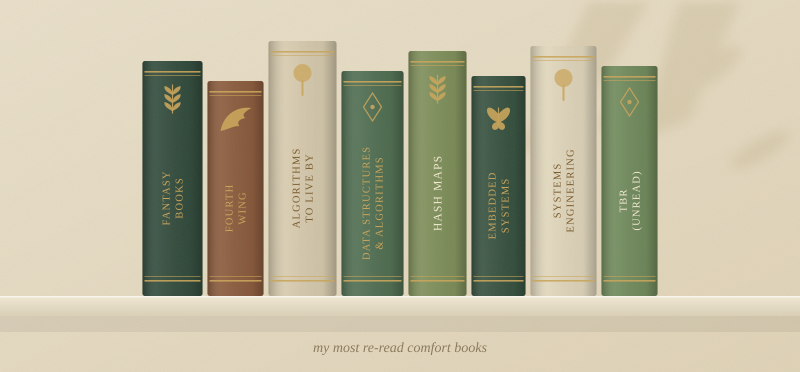
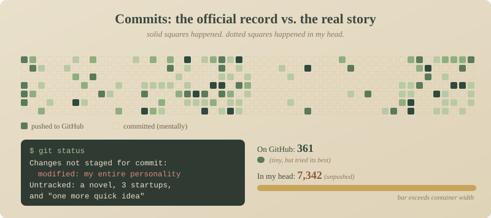

# Anusha's GitHub Marginalia

*I can’t go two days without coding, or I forget my 35 years of experience. (I’m 24.)*

---

## Prologue  🕯️ 

A girl from the planet Earth learned that **compilers throw errors and dragons can throw blue fire**, and decided she liked both. Now she studies CS at NYU Courant and builds things with ML, embedded systems, and an unreasonable amount of vanilla latte.

> *"I'll just read one chapter" — oh, the lies I tell myself at 11 PM.*

---

## My Library

*Only 6,457 books. I have self-control.*

---

## Choose Your Path

🚪 <b>I'm a recruiter / hiring manager</b>

 

- 🎓 MS in Computer Science @ NYU Courant (Spring 2027)
- 🛠️ ML/AI engineering, embedded systems, SWE.
- 💼 Summer'26 interned @Qualcomm, previously a Software engineer @Bridgeline Digital in NYC, and before that I co-founded an IT consultancy.
- 📬 [Send a raven](#send-a-raven)

*Yes, yes, I know the README is whimsical. The code is not. It has linting and everything.*

🚪 <b>I just want book recommendations</b>

 

Oh, you kindred spirit. My shelf leans mostly towards **fantasy**: big worlds, complicated magic systems, and characters who make terrible decisions, aka rage-baiting you. Tell me what you love, and I'll tell you what to read next. I do read some fantastic non-fiction books as well; my latest read was Algorithms to Live By, by Brian Christian and Tom Griffiths. 

🚪 <b>I'm here for the stories</b>

 

Uh-ya, I guess I write too. Find my words at **[@theunscratchedstories](https://instagram.com/theunscratchedstories)**.

---

## The Commit Ledger
*GitHub is a pure aura-farming place, and I don't have any. Yet. Tsk, tsk, tsk.*

---

## Side-Quest Log

| Quest | Status | Spoils |
|-------|--------|--------|
| **[Sigyl](https://github.com/Anusha3002/sigyl)** | In progress | *Computer Vision Gaming Project coming soon* |
| **[QuantIAN](https://github.com/Anusha3002/QuantIAN)** | Completed | *a multi-cloud, peer-to-peer financial analytics platform* |

---

## Send a Raven

*Ravens are super slow, and email is faster, but the raven aesthetic? tsk tsk non-negotiable.*

### *Thank you for spending 2.5 minutes of your life. There's always a sequel coming up soon :)* 

